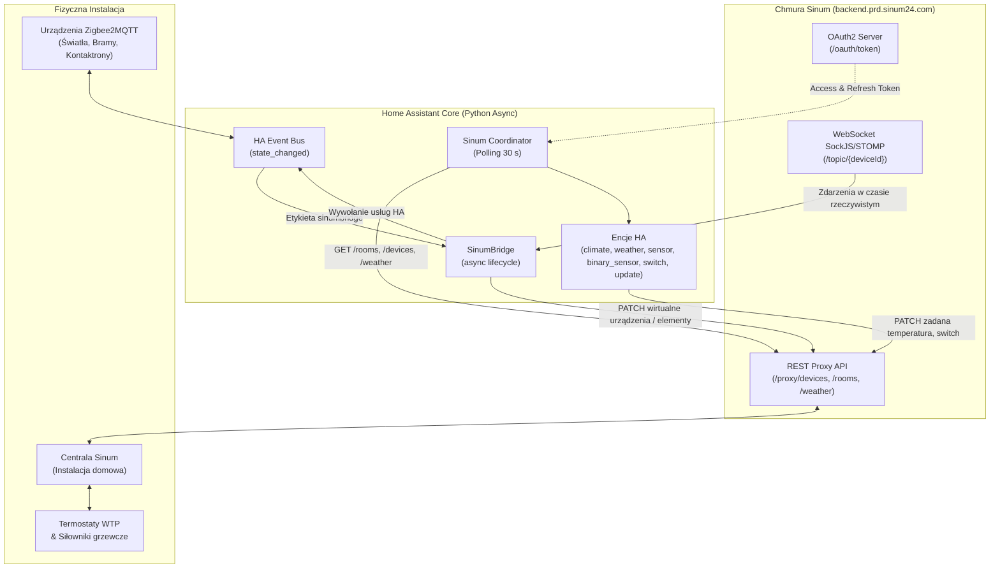

# Sinum Home Assistant

<p align="center">
  
</p>

[](https://hacs.xyz)
[](https://www.home-assistant.io)
[](LICENSE)
[](https://github.com/lkusinski/sinum-home-assistant/actions/workflows/validate.yml)

**Sinum Home Assistant** to niezależna, zaawansowana integracja dla central i automatyki domowej **Sinum** firmy **TECH Sterowniki**.

Integracja komunikuje się bezpośrednio z chmurą Sinum Cloud API, automatycznie mapuje pokoje 1:1 na obszary Home Assistant i udostępnia natywne encje klimatu, pogody, przekaźników, harmonogramów, diagnostyki oraz aktualizacji oprogramowania. Zawiera także wbudowany, działający asynchronicznie dwukierunkowy most **Home Assistant / Zigbee2MQTT ↔ Sinum** (`SinumBridge`), który pozwala prezentować i sterować urządzeniami z Home Assistant bezpośrednio w aplikacji i ekosystemie Sinum.

---

## Spis treści

- [Główne możliwości](#główne-możliwości)
- [Szczery stan integracji (Co działa, a czego brakuje)](#szczery-stan-integracji)
- [Architektura integracji i mostu](#architektura-integracji-i-mostu)
- [Instalacja](#instalacja)
- [Konfiguracja](#konfiguracja)
- [Encje i platformy](#encje-i-platformy)
- [Dostępne usługi](#dostępne-usługi)
- [Wbudowany most HA / Z2M ↔ Sinum](#wbudowany-most-ha--z2m--sinum)
- [Dokumentacja szczegółowa](#dokumentacja-szczegółowa)
- [Prawa autorskie i znaki towarowe](#prawa-autorskie-i-znaki-towarowe)
- [English Documentation](#english)

---

## Główne możliwości

- **Natywne encje klimatu (`climate`)**: Pełna obsługa termostatów pokojowych i regulatorów WTP. Odczyt temperatury bieżącej, nastawa temperatury zadanej z krokiem 0.5 °C, tryby pracy HVAC oraz stan aktywności (`hvac_action`: grzanie / chłodzenie / bezczynność / wyłączone).
- **Automatyczne obszary 1:1 z pokojami Sinum**: Każdy pokój zdefiniowany w centrali Sinum staje się obszarem (Area) w Home Assistant z automatycznie przypisanymi encjami temperatury i wilgotności.
- **Kompletna stacja pogodowa (`weather` + sensory)**: Warunki bieżące oraz prognoza godzinowa i dzienna z centrali Sinum (temperatura, wilgotność, ciśnienie, prędkość wiatru, indeks UV, promieniowanie słoneczne).
- **Bezpieczne sterowanie przekaźnikami**:
  - Wolne wyjścia przekaźnikowe centrali jako przełączniki (`switch`).
  - Przekaźniki przypisane do stref termostatów są bezpiecznie wystawiane jako sensory dwustanowe (`binary_sensor`) i atrybuty diagnostyczne (`relay_ids`, `relay_states`, `relay_last_changes`), chroniąc instalację przed konfliktami ze sterownikiem Sinum.
- **Monitoring aktualizacji firmware (`update`)**: Encje aktualizacji dla centrali, sterowników, transceiverów i modułów rozszerzeń (wykrywa również wersje dostępne w chmurze, niewidoczne jeszcze w aplikacji mobilnej).
- **Harmonogramy termiczne**: Odczyt aktualnej nastawy z aktywnego harmonogramu, stan aktywności oraz temperatura zapasowa w atrybutach.
- **Wbudowany most dwukierunkowy (`SinumBridge`)**: Działa wewnątrz integracji na pętli zdarzeń Home Assistant. Umożliwia wystawienie żarówek (włącz/wyłącz, jasność, RGB, barwa biała Kelvin), kontaktronów, bram, czujników temp/wilgotności oraz klimatyzacji AC do aplikacji Sinum.
- **Komunikacja push w czasie rzeczywistym**: Most wykorzystuje strumień WebSocket STOMP/SockJS w chmurze Sinum — zmiany z aplikacji Sinum trafiają do Home Assistant w ułamku sekundy (< 1 s).
- **Bezpieczne uwierzytelnianie**: Hasło do konta Sinum jest używane wyłącznie jednorazowo podczas konfiguracji do pobrania tokenów. W konfiguracji zapisywany jest wyłącznie `refresh_token`, a tokeny dostępowe odnawiają się automatycznie w pamięci.

---

## Szczery stan integracji

Poniższa macierz przedstawia rzeczywisty, rzetelny stan wdrożenia — bez koloryzowania. Rozróżniamy to, co zostało zweryfikowane na fizycznym sprzęcie w działającej instalacji domowej, co sprawdzono na laboratoryjnej ławce testowej, a co stanowi ograniczenie lub plan na przyszłość.

| Funkcja / Komponent | Status | Środowisko weryfikacji | Szczegóły i uwagi |
|---|:---:|---|---|
| **Chmura Sinum Cloud API & OAuth2** | ✅ Przetestowane | Fizyczna instalacja domowa | Logowanie, odnawianie `refresh_token`, obsługa błędów sieci i restartów. |
| **Obszary (Areas) 1:1 z pokojami Sinum** | ✅ Przetestowane | Fizyczna instalacja domowa | 9 pokoi zmapowanych automatycznie, przypięte sensory temp/wilgotności. |
| **Termostaty pokojowe i WTP (`climate`)** | ✅ Przetestowane | Fizyczna instalacja domowa | Odczyt temp, nastawa zadana (krok 0.5 °C), `hvac_action` (heating/idle/off). |
| **Stacja pogodowa & prognoza (`weather`)** | ✅ Przetestowane | Fizyczna instalacja domowa | Warunki bieżące, prognoza godzinowa i dzienna, indeks UV, ciśnienie, wiatr. |
| **Wolne przekaźniki centrali (`switch`)** | ✅ Przetestowane | Fizyczna instalacja domowa | Sterowanie ON/OFF wolnymi wyjściami przekaźnikowymi centrali. |
| **Przekaźniki termostatów (strefowe)** | ✅ Przetestowane | Fizyczna instalacja domowa | Wyłącznie odczyt jako `binary_sensor` + atrybuty. Chmura Sinum odrzuca bezpośrednie przełączanie. |
| **Aktualizacje firmware (`update`)** | ✅ Przetestowane | Fizyczna instalacja domowa | Odczyt wersji zainstalowanej i najnowszej w chmurze. Fizyczna instalacja z aplikacji Sinum. |
| **Harmonogramy termiczne** | ✅ Przetestowane | Fizyczna instalacja domowa | Encje sensora temperatury harmonogramu i binary_sensor aktywności. |
| **Most: Żarówki Z2M/HA (`color_picker`)** | ✅ Przetestowane | Fizyczna instalacja domowa | Dwukierunkowe sterowanie: on/off, jasność, kolor RGB, temperatura barwowa (Kelvin). |
| **Most: Kontaktrony drzwi/okien** | ✅ Przetestowane | Fizyczna instalacja domowa | Zmiana stanu w HA aktualizuje widget tekstowy w Sinum (`Otwarte`/`Zamknięte`). |
| **Most: Brama garażowa (impulsowa)** | ✅ Przetestowane | Fizyczna instalacja domowa | Sterowanie impulsem, obsługa odwróconego czujnika zamknięcia (`invert: true`). |
| **Most: Sensory temperatury i wilgotności** | ✅ Przetestowane | Fizyczna instalacja domowa | Wartość numeryczna w chmurze + formatowany element tekstowy w UI Sinum. |
| **Most: Push WebSocket STOMP/SockJS** | ✅ Przetestowane | Fizyczna instalacja domowa | Zdarzenia z Sinum trafiają do HA w ~0.45–0.9 s; eliminacja pętli zwrotnych (echo). |
| **Wirtualne urządzenia natywne Sinum** | 🧪 LAB Bench | Wirtualna centrala / LAB | Wirtualny termostat, brama, furtka, heat pump manager, integratory rolet i dimmerów. |
| **Moduł klimatyzacji AC (`ac_module`)** | 🧪 LAB Bench | Moduł Lua w LAB Wirtualne | Dwukierunkowe mapowanie z encją `climate` w HA (tryby auto/cool/heat/fan/dry, nastawa). |
| **32 moduły rozszerzeń Lua Sinum** | 🧪 LAB Bench | Moduły Lua w LAB Wirtualne | Moduły przekaźników, ściemniaczy, RGB, liczników energii/wody, czujników CO2/IAQ/jakości powietrza. |
| **Wszystkie 11 kontrolek UI Sinum** | 🧪 LAB Bench | Wirtualna centrala / LAB | `text`, `switcher`, `progress_bar`, `slider`, `button`, `combo_box`, `device_selector`, `schedule_selector`, `time_picker`, `date_picker`, `color_picker`. |
| **Statystyki InfluxDB dla custom devices** | 🧪 LAB Bench | Wirtualna centrala / LAB | Wstrzykiwanie kodu Lua `statistics:addPoint` generuje punkty pomiarowe dla wykresów w Sinum. |
| **Komunikacja lokalna (LAN)** | ℹ️ Nie testowano | Poza zakresem wdrożenia | Home Assistant i centrala Sinum pracują w niezależnych podsieciach/lokalizacjach. Integracja została zaprojektowana i zweryfikowana pod kątem bezpośredniej komunikacji z oficjalną chmurą Sinum Cloud API, co umożliwia stabilną pracę także w konfiguracjach zdalnych (poza wspólnym LAN). |
| **Kamery RTSP / NVR w Sinum** | ❌ Nieobsługiwane | Ograniczenie chmury Sinum | API chmury Sinum zwraca błąd `422 NvrDeviceNotFound` przy próbie dodania wirtualnego strumienia RTSP. |
| **Rolety i żaluzje (Cover) z HA w Sinum** | ❌ Brak typu | Ograniczenie wirtualnych urządzeń | Sinum nie posiada wariantu wirtualnego urządzenia dla rolet. Integrator rolet działa tylko ze sprzętem TECH. |
| **Status online dla custom sensorów** | ⚠️ Ograniczenie UI | Kosmetyczne zachowanie Sinum | Wirtualne sensory w Sinum zgłaszają stan `unknown` na liście urządzeń, mimo że ich widgety i wartości działają. |
| **Bramy jako przycisk monostabilny** | ⚠️ Do ulepszenia | Wdrożone jako switch | Most symuluje przycisk poprzez przełącznik wysyłający impuls, a nie natywny momentary button. |

---

## Architektura integracji i mostu

Integracja łączy dwie warstwy komunikacji:



1. **Sinum → Home Assistant**:
   - Coordinator odpytuje chmurę Sinum w konfigurowalnym interwale (domyślnie 30 s).
   - Generuje i aktualizuje stan encji klimatu, pogody, przekaźników i sensorów.
   - Odpowiedzi są filtrowane pod kątem urządzeń oznaczonych `integration_uid: z2m-bridge`, dzięki czemu wirtualne urządzenia mostu nie tworzą zapętlonych duplikatów w Home Assistant.
2. **Home Assistant ↔ Sinum (Most `SinumBridge`)**:
   - Wybiera encje oznaczone etykietą w Home Assistant (domyślnie **`sinumbridge`**, z zachowaniem wstecznej kompatybilności dla etykiety `sinum`).
   - Reaguje na zdarzenia `state_changed` na magistrali Home Assistant i natychmiast wysyła polecenia REST/PATCH do wirtualnych odpowiedników w chmurze Sinum.
   - Utrzymuje asynchroniczne połączenie WebSocket STOMP/SockJS z chmurą Sinum. Zmiany wykonane przez użytkownika w aplikacji Sinum natychmiast wywołują odpowiednie usługi w Home Assistant.
   - Posiada mechanizm tłumienia echa (`echo suppression`), zapobiegający pętlom sprzężenia zwrotnego pomiędzy systemami.

---

## Instalacja

### HACS (Rekomendowane)

1. Upewnij się, że masz zainstalowany **HACS** w Home Assistant.
2. Przejdź do **HACS → Integracje**.
3. Kliknij menu w prawym górnym rogu (trzy kropki) i wybierz **Niestandardowe repozytoria**.
4. Wklej adres repozytorium:
   ```text
   https://github.com/lkusinski/sinum-home-assistant
   ```
5. Wybierz kategorię **Integracja** i kliknij **Dodaj**.
6. Wyszukaj **Sinum Home Assistant**, kliknij **Pobierz** i zrestartuj Home Assistant.
7. Po restarcie przejdź do **Ustawienia → Urządzenia i usługi → Dodaj integrację** i wybierz **Sinum Home Assistant**.

[](https://my.home-assistant.io/redirect/hacs_repository/?owner=lkusinski&repository=sinum-home-assistant&category=integration)

### Instalacja ręczna

1. Pobierz najnowsze wydanie z zakładki [Releases](https://github.com/lkusinski/sinum-home-assistant/releases).
2. Skopiuj katalog `custom_components/sinum_home_assistant` do folderu `config/custom_components/` w Twojej instalacji Home Assistant.
3. Zrestartuj Home Assistant.
4. Przejdź do **Ustawienia → Urządzenia i usługi → Dodaj integrację** i wyszukaj **Sinum Home Assistant**.

---

## Konfiguracja

W kreatorze konfiguracji (UI) podaj:

1. **Adres e-mail** i **hasło** do konta w aplikacji Sinum.
2. **Identyfikator centrali w chmurze (`uid`)** — znajdziesz go w aplikacji mobilnej Sinum w szczegółach centrali lub w menu ustawień zaawansowanych.

> [!NOTE]
> Hasło jest wykorzystywane wyłącznie jednorazowo w procesie OAuth2. W konfiguracji Home Assistant przechowywany jest wyłącznie token odświeżania (`refresh_token`).

### Dostępne opcje integracji

W dowolnym momencie możesz zmienić ustawienia integracji w **Ustawienia → Urządzenia i usługi → Sinum Home Assistant → Konfiguruj**:

| Opcja | Domyślnie | Zakres | Opis |
|---|:---:|:---:|---|
| **Interwał odpytywania chmury** | `30 s` | 15–300 s | Częstotliwość pełnego cyklu odczytu stanu urządzeń z chmury Sinum. |
| **Włącz stację pogodową** | `Włączona` | Tak / Nie | Tworzy encję pogody oraz czujniki wiatru, ciśnienia, UV i nasłonecznienia. |
| **Włącz moduły systemowe** | `Włączona` | Tak / Nie | Dodaje diagnostykę extenderów, transceiverów i modułów radiowych. |
| **Włącz harmonogramy** | `Włączona` | Tak / Nie | Dodaje encje harmonogramów ogrzewania i ich bieżącego stanu. |
| **Włącz most do Sinum** | `Włączony` | Tak / Nie | Uruchamia asynchroniczny most `SinumBridge` dla wybranych urządzeń HA. |
| **Etykieta urządzeń mostu** | `sinumbridge` | Tekst | Urządzenia i encje HA oznaczone tą etykietą będą synchronizowane z Sinum. |
| **Domyślny pokój Sinum dla mostu** | `0` | Liczba ID | ID pokoju Sinum, do którego trafiają nowo tworzone wirtualne urządzenia (`0` = bez przypisania). |

---

## Encje i platformy

Integracja udostępnia następujące platformy:

- **`climate`**: Termostaty pokojowe Sinum oraz regulatory WTP.
  - Sterowanie temperaturą zadaną (krok 0.5 °C).
  - Odczyt temperatury bieżącej.
  - Informacja o trybie pracy (`hvac_action`: heating / cooling / idle / off).
  - W atrybutach: przypisane przekaźniki grzewcze, ich stany oraz wiek ostatniej zmiany.
- **`weather`**: Pełna prognoza pogody dla lokalizacji centrali.
  - Stan bieżący, prognoza godzinowa i prognoza dzienna.
- **`sensor`**: Temperatura, wilgotność, poziom baterii, jakość sygnału radiowego, czasy pracy centrali, adres IP, opóźnienie sieciowe, harmonogramy.
- **`binary_sensor`**: Stan otwarcia okien (kontaktrony), stan aktywności grzania/chłodzenia, osiągnięcie temperatury docelowej, ostrzeżenia systemowe oraz bezpieczny stan przekaźników strefowych.
- **`switch`**: Niezależne, wolne wyjścia przekaźnikowe centrali Sinum.
- **`update`**: Dostępność aktualizacji oprogramowania dla centrali i urządzeń podrzędnych.

---

## Dostępne usługi

Integracja rejestruje następujące usługi w Home Assistant:

### 1. `sinum_home_assistant.set_virtual_temperature`
Wysyła wartość temperatury z Home Assistant do wirtualnego czujnika temperatury w Sinum. Umożliwia przekazanie pomiaru z dowolnego sensora Zigbee, BLE, ESPHome lub encji pomocniczej do sterownika Sinum.

```yaml
action: sinum_home_assistant.set_virtual_temperature
data:
  device_id: 124
  temperature: 21.8
```

### 2. `sinum_home_assistant.refresh`
Wymusza natychmiastowe odpytanie chmury Sinum przez koordynatora, bez oczekiwania na upływ 30-sekundowego interwału.

```yaml
action: sinum_home_assistant.refresh
```

---

## Wbudowany most HA / Z2M ↔ Sinum

Most `SinumBridge` rozwiązuje częsty problem: jak w jednej aplikacji Sinum kontrolować zarówno ogrzewanie TECH, jak i żarówki, kontaktrony czy bramy podłączone do Home Assistant / Zigbee2MQTT.

### Jak dodać urządzenie do mostu?
1. Otwórz Home Assistant i przejdź do rejestru urządzeń lub encji (**Ustawienia → Urządzenia i usługi → Urządzenia/Encje**).
2. Dodaj etykietę **`sinumbridge`** do urządzenia lub encji, którą chcesz widzieć w Sinum.
3. Most automatycznie utworzy odpowiednie wirtualne urządzenie w chmurze Sinum i rozpocznie dwukierunkową synchronizację stanu.

### Obsługiwane typy urządzeń w moście:

| Typ w HA | Wariant Sinum | Elementy UI Sinum | Obsługiwane funkcje |
|---|---|---|---|
| **Światło (`light`)** | `generic` | `color_picker` | Włącz/Wyłącz, Jasność (0–100%), Kolor RGB, Barwa biała (Kelvin). |
| **Kontaktron (`binary_sensor`)** | `two_state_input_sensor` | `text` | Stan otwarcia (`Otwarte` / `Zamknięte`), obsługa inwersji. |
| **Brama garażowa / wjazdowa** | `gate` (wirtualna) / `relay` | `switcher` / status | Impuls sterujący, monitorowanie stanu otwarcia/zamknięcia. |
| **Temperatura (`sensor`)** | `temperature_sensor` | `text` (tekst-default) | Wartość numeryczna + czytelny format np. `21.4 °C`. |
| **Wilgotność (`sensor`)** | `humidity_sensor` | `text` (tekst-default) | Wartość numeryczna + czytelny format np. `55.0 %`. |
| **Wielkości analogowe (moc, energia, bateria)** | `analog_input` / `energy_meter` | Wartości wariantu | Jednostki dopasowane automatycznie (W, kWh, %, V). |
| **Klimatyzator (`climate`)** | `custom_device_module` | Moduł AC | Tryby pracy (auto, chłodzenie, grzanie, wentylator, osuszanie), nastawa temperatury. |

---

## Dokumentacja szczegółowa

Więcej informacji technicznych i poradników znajduje się w katalogu `docs/`:

- [Instalacja krok po kroku](docs/INSTALL.md)
- [Szczegółowa konfiguracja opcji](docs/CONFIGURATION.md)
- [Katalog encji i atrybutów](docs/ENTITIES.md)
- [Architektura mostu Z2M ↔ Sinum](docs/BRIDGE-Z2M.md)
- [Moduły rozszerzeń Lua w Sinum](docs/SINUM-LUA-MODULES.md)
- [Rozwiązywanie problemów (Troubleshooting)](docs/TROUBLESHOOTING.md)
- [Polityka prywatności i bezpieczeństwa danych](docs/PRIVACY.md)
- [Klasyfikacja encji i zalecane etykiety](docs/LABELS.md)
- [Stan techniczny projektu i roadmapa](docs/PROJECT-STATE.md)

---

## Prawa autorskie i znaki towarowe

- Kod integracji jest udostępniany na licencji **MIT License** — Copyright © 2026 **Łukasz Kusiński**. Zobacz [LICENSE](LICENSE).
- Nazwy **Sinum** oraz **TECH Sterowniki** są zarejestrowanymi znakami towarowymi firmy **TECH Sterowniki Sp. z o.o.**
- Ten projekt jest niezależną, społecznościową integracją Home Assistant i nie jest oficjalnym produktem firmy TECH Sterowniki Sp. z o.o.

---

## English

**Sinum Home Assistant** is a native, comprehensive Home Assistant integration for **Sinum** heating and home automation systems manufactured by **TECH Sterowniki**.

It connects directly to the Sinum Cloud API, maps rooms 1:1 to Home Assistant Areas, and provides native entities for climate control, weather monitoring, relay management, schedules, diagnostics, and firmware updates. It also includes an asynchronous, real-time bidirectional **Home Assistant / Zigbee2MQTT ↔ Sinum bridge** (`SinumBridge`), enabling you to view and control your Home Assistant devices directly from the Sinum mobile app.

### Key Features

- **Native Climate Entities**: Room thermostats and WTP temperature regulators with 0.5 °C setpoint control, current temperature tracking, HVAC modes, and heating/cooling action states (`hvac_action`).
- **Automatic 1:1 Area Mapping**: Sinum rooms are mirrored as Home Assistant Areas with temperature and humidity entities assigned automatically.
- **Weather Station & Forecasts**: Hourly and daily weather forecasts, solar irradiance, UV index, wind speed, atmospheric pressure, and humidity.
- **Safe Relay Management**: Free relay outputs are exposed as switches; thermostat-controlled heating relays are exposed as read-only binary sensors and diagnostic attributes to prevent equipment damage and conflicting logic.
- **Firmware Update Tracking**: Monitors available firmware updates for the hub, parent controllers, repeaters, and transceivers directly from the cloud.
- **Built-in Async Bridge (`SinumBridge`)**: Bridges Zigbee2MQTT lights (RGB, color temperature in Kelvin, brightness), door/window contacts, impulse garage gates, environmental sensors, and AC modules into Sinum using standard Home Assistant device labels (default: `sinumbridge`).
- **Real-Time Push via WebSocket**: The bridge listens to real-time Sinum cloud STOMP/SockJS events (< 1 s latency) with built-in echo suppression.
- **Secure OAuth2 Authentication**: Passwords are used only once during initial setup; only the `refresh_token` is stored, and access tokens rotate in memory automatically.

### Honest Implementation Status

| Feature / Platform | Status | Verified In | Details |
|---|:---:|---|---|
| **Sinum Cloud API & OAuth2** | ✅ Verified | Physical home setup | Automatic token refresh, network reconnects, and session recovery. |
| **Room 1:1 Area Mapping** | ✅ Verified | Physical home setup | 9 rooms mapped with assigned temperature/humidity sensors. |
| **Thermostats & WTP Regulators** | ✅ Verified | Physical home setup | Setpoint adjustments (0.5 °C steps), current temperature, `hvac_action`. |
| **Weather & Daily Forecast** | ✅ Verified | Physical home setup | Current conditions, hourly/daily forecasts, UV index, pressure, wind. |
| **Free Relay Switches** | ✅ Verified | Physical home setup | Reliable ON/OFF switching of unassigned physical relay outputs. |
| **Thermostat-Assigned Relays** | ✅ Verified | Physical home setup | Read-only state sensors & attributes; cloud API rejects direct overrides. |
| **Firmware Update Sensors** | ✅ Verified | Physical home setup | Cloud version detection. Installation triggered via Sinum mobile app. |
| **Bridge: Zigbee Lights (`color_picker`)** | ✅ Verified | Physical home setup | Bidirectional: on/off, brightness, RGB colors, Kelvin white temperatures. |
| **Bridge: Door/Window Contacts** | ✅ Verified | Physical home setup | Real-time state updates in Sinum text elements (`Open` / `Closed`). |
| **Bridge: Impulse Garage Gate** | ✅ Verified | Physical home setup | Pulse command triggers with inverted close-status contact support. |
| **Bridge: Temp / Humidity Sensors** | ✅ Verified | Physical home setup | Numeric values and human-readable text representations in Sinum UI. |
| **Bridge: Real-Time WebSocket Push** | ✅ Verified | Physical home setup | Sub-second latency (~0.45–0.9 s) with bidirectional echo suppression. |
| **Native Virtual Devices** | 🧪 LAB Bench | Virtual testbed | Virtual thermostats, gates, wickets, heat pump managers, blind integrators. |
| **AC Climate Module (`ac_module`)** | 🧪 LAB Bench | Virtual testbed | Bidirectional mapping to HA `climate` (auto/cool/heat/fan/dry modes). |
| **32 Sinum Lua Modules** | 🧪 LAB Bench | Virtual testbed | Validated modules for dimmers, meters, pumps, inverters, and EV chargers. |
| **11 Sinum UI Element Types** | 🧪 LAB Bench | Virtual testbed | All custom UI controls rendered and tested against cloud REST endpoints. |
| **InfluxDB Statistics Injection** | 🧪 LAB Bench | Virtual testbed | Lua `statistics:addPoint` scripts generate historical graphs in Sinum. |
| **Local LAN Connection** | ℹ️ Untested | Out of current scope | Home Assistant and the Sinum hub reside in separate subnets/locations. The integration is designed and verified against the official Sinum Cloud API, enabling reliable remote operation without requiring a shared local LAN. |
| **RTSP / NVR Video in Sinum** | ❌ Unsupported | Cloud API limitation | Cloud API returns `422 NvrDeviceNotFound` for virtual generic RTSP cameras. |
| **Covers / Blinds from HA to Sinum** | ❌ Unsupported | Virtual device limitation | Sinum has no virtual variant for covers or blinds. |
| **Online Status on Custom Sensors** | ⚠️ Cosmetic | Sinum UI behavior | Virtual custom sensors report `unknown` status in Sinum UI, though values work. |
| **Gates as Monostable Buttons** | ⚠️ Roadmap | Implemented as switch | Currently triggered via a pulse switch rather than a native monostable button. |

### Installation

1. Add `https://github.com/lkusinski/sinum-home-assistant` as a custom repository in **HACS → Integrations**.
2. Download **Sinum Home Assistant** and restart Home Assistant.
3. Navigate to **Settings → Devices & Services → Add Integration** and select **Sinum Home Assistant**.
4. Enter your Sinum account credentials and cloud device ID (`uid`).
