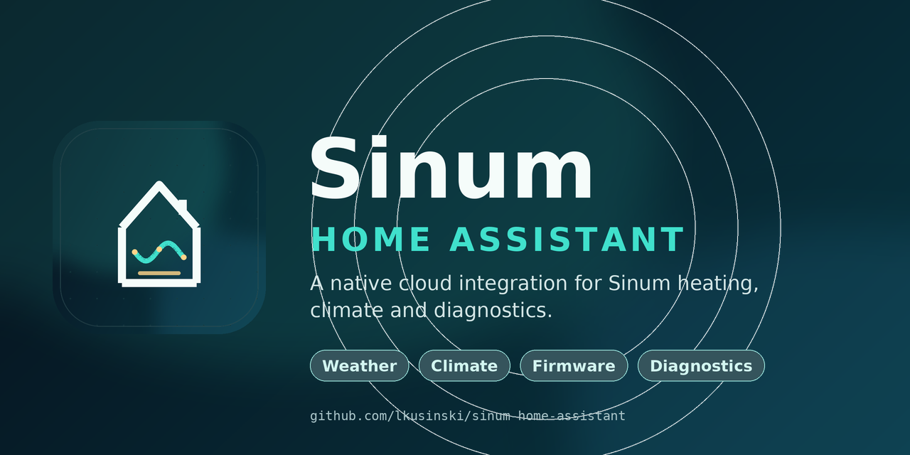
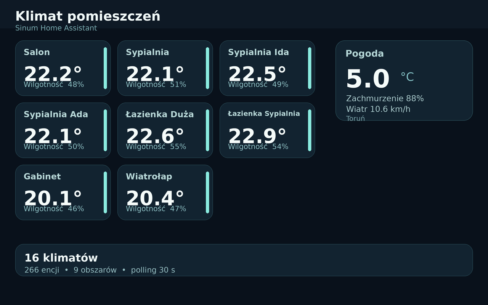

# Sinum Home Assistant

**Sinum Home Assistant** to natywna integracja Home Assistant dla systemów
grzewczych i automatyki domowej **Sinum** firmy **Tech Sterowniki**.

Integracja łączy się bezpośrednio z chmurą Sinum, automatycznie mapuje pokoje
i urządzenia oraz tworzy natywne encje Home Assistant do sterowania klimatem,
pogodą, przekaźnikami, diagnostyką i aktualizacjami firmware. Repozytorium
zawiera też opcjonalny, event-driven most **Zigbee2MQTT/HA ↔ Sinum**,
uruchamiany przez integrację. Wybór urządzeń odbywa się etykietą HA, a nie przez
sztywne pokoje LAB.

## Najważniejsze cechy

- **Natywne encje klimatu** dla termostatów Sinum i regulatorów temperatury WTP.
- **Temperatura bieżąca, temperatura docelowa i `hvac_action`** zgodne
  ze standardowym modelem klimatu Home Assistant.
- **Encja pogody z prognozą godzinną i dzienną** — temperatura, wilgotność,
  ciśnienie, wiatr, indeks UV i irradiancja słoneczna.
- **Encje aktualizacji firmware**, również dla urządzeń, których aktualizacja
  jest dostępna w chmurze, ale nie jest widoczna w aplikacji.
- **Obszary 1:1 z pokojami Sinum** — automatyczne przypisywanie pokoi,
  kontrolerów, czujników, przekaźników i modułów systemowych.
- **Harmonogramy termiczne** — temperatura docelowa i informacja o aktywnym
  przedziale; temperatura zapasowa i liczba urządzeń w atrybutach.
- **Przełączniki wolnych przekaźników**, encje stanu przekaźników zarządzanych
  przez termostat oraz szeroki zestaw diagnostyki: sygnał, bateria, czas pracy,
  adres IP, opóźnienie i kanał sieci.
- **Konfiguracja przez UI** — bez YAML; opcje mostu: ekspozycja, etykieta `sinumbridge`, docelowy pokój Sinum.
- **Most w integracji** — async HA event bus + Sinum REST/STOMP, bez zewnętrznych usług systemd.
- **Uwierzytelnianie refresh tokenem** — hasło jest używane tylko podczas
  konfiguracji lub ponownego uwierzytelnienia i nie jest zapisywane.
- **Oszczędne odpytywanie chmury** — jeden cykl aktualizacji co 30 sekund
  (integracja); most LAB działa event-driven, a 300 s to tylko reconciliation.
- **Automatyczne wykrywanie nowych urządzeń** — dodanie urządzenia lub harmonogramu
  w Sinum przeładowuje integrację i tworzy nowe encje.
- **Most HA/Z2M → Sinum** — HA `state_changed` i Sinum STOMP/SockJS,
  światła z `color_picker`, kontaktrony, bramy, moduł AC i statystyki Lua.
- **Test bench LAB** — LAB Lukasz (11), LAB Działające (12) i LAB Wirtualne
  (13) służą do walidacji; nie są docelowym ograniczeniem produktu.

## Podgląd

## Instalacja

### HACS (zalecane)

1. Otwórz **HACS → Integracje**.
2. Z menu wybierz **Repozytoria niestandardowe**.
3. Dodaj `https://github.com/lkusinski/sinum-home-assistant` jako **Integrację**.
4. Wyszukaj **Sinum Home Assistant**, zainstaluj i uruchom ponownie Home Assistant.
5. Przejdź do **Ustawienia → Urządzenia i usługi → Dodaj integrację →
   Sinum Home Assistant**.

### Instalacja ręczna

Skopiuj katalog `custom_components/sinum_home_assistant` do
`config/custom_components/` w Home Assistant, a następnie uruchom ponownie HA.

## Konfiguracja

Potrzebujesz:

- adresu e-mail i hasła do konta Sinum, do którego należy centrala;
- **cloud device ID** (`uid`) centrali Sinum.

Cloud device ID znajdziesz w aplikacji Sinum lub w ustawieniach centrali.
Integracja zapisuje wyłącznie adres e-mail, device ID i refresh token. Hasło
nie jest przechowywane.

### Opcje

| Opcja | Domyślnie | Opis |
|---|---:|---|
| Interwał odpytywania | 30 s | Zakres 15–300 sekund. |
| Pogoda | włączona | Dodaje encję pogody i prognozę. |
| Moduły systemowe | włączone | Dodaje diagnostykę extenderów i transceiverów. |
| Harmonogramy | włączone | Dodaje harmonogramy termiczne i ich stan. |

Zmiana opcji przeładowuje integrację. Wyłączenie pogody lub modułów systemowych
usuwa powiązane encje z rejestru; ponowne włączenie odtwarza je z tymi samymi
identyfikatorami.

## Encje

W typowej instalacji powstają:

| Platforma | Przykłady |
|---|---|
| `climate` | Termostaty pokojowe i regulatory temperatury WTP |
| `weather` | Warunki bieżące oraz prognoza godzinowa i dzienna |
| `sensor` | Temperatura, wilgotność, bateria, sygnał, IP, opóźnienie, firmware |
| `binary_sensor` | Kontakt okna, grzanie/chłodzenie, ostrzeżenia, stan przekaźnika |
| `switch` | Wolne wyjścia przekaźnikowe |
| `update` | Firmware centrali, kontrolerów, extenderów i urządzeń |
| `sensor`/`binary_sensor` | Harmonogramy: temperatura docelowa i aktywność; zapasowa/liczba urządzeń w atrybutach |

Przekaźniki zarządzane przez termostat wirtualny są **tylko do odczytu** —
chmura Sinum nie pozwala sterować nimi bezpośrednio. Są widoczne jako
`binary_sensor` „Stan przekaźnika”. Wolne przekaźniki działają jako switche.

Identyfikatory encji tworzone są z nazwy pokoju, urządzenia i właściwości.
Obszary i urządzenia są tworzone automatycznie.

## Most Z2M → Sinum

Most jest częścią integracji i działa w jej lifecycle:

- `custom_components/sinum_home_assistant/bridge.py` — async mapper, HA event
  bus, Sinum REST oraz strumień STOMP/SockJS w obie strony.
- Mapowanie jest zapisywane w HA storage i może zostać zaimportowane z
  `bridge/mapping.json` przy pierwszym uruchomieniu.
- Skrypty `bridge/event_worker.py`, `bridge/z2m_to_sinum.py` i
  `bridge/map_z2m.py` pozostają jako legacy/reference; nie są wymagane.

Most obsługuje światła `generic` + `color_picker` (on/off, jasność, RGB,
temperatura barwowa), kontaktrony, przekaźniki/bramy, sensory temperatury i
wilgotności, wartości analogowe, energię, baterię oraz moduł AC
`custom_device_module`. Szczegóły:
[docs/BRIDGE-Z2M.md](docs/BRIDGE-Z2M.md) i
[docs/SINUM-LUA-MODULES.md](docs/SINUM-LUA-MODULES.md).

Wybór odbywa się etykietą HA (domyślnie **`sinumbridge`**, legacy `sinum`).
Obecny test używa pokoi **LAB Lukasz (11)**, **LAB Działające (12)** i
**LAB Wirtualne (13)**; produkcyjne HA Wiśniowa 9 jest tylko źródłem odczytu.

## Wymagania

- Home Assistant **2026.11** lub nowszy.
- Konto Sinum z dostępem do chmury.
- Dostęp do internetu i `backend.prd.sinum24.com`.

## Prywatność

Integracja komunikuje się wyłącznie z endpointami chmury Sinum potrzebnymi do
odczytu stanu urządzeń i wysyłania poleceń sterujących. Przechowuje adres
e-mail, cloud device ID i refresh token w config entry Home Assistant. Hasło nie
jest zapisywane. Dane nie są wysyłane do żadnych innych usług.

Szczegóły: [docs/PRIVACY.md](docs/PRIVACY.md).

## Rozwiązywanie problemów

- **Nieprawidłowy e-mail lub hasło** — sprawdź dane konta Sinum.
- **Nieprawidłowy cloud device ID** — skopiuj `uid` z aplikacji lub ustawień centrali.
- **Brak połączenia** — sprawdź internet i dostępność chmury Sinum.
- **Część czujników ma stan `unknown`** — puste pola sieciowe transceiverów są
  normalne.
- **Nazwy encji różnią się od aplikacji** — Home Assistant używa nazw pokoju
  i urządzenia; encje można zmienić w UI.

Więcej: [docs/TROUBLESHOOTING.md](docs/TROUBLESHOOTING.md).

## Dokumentacja

- [Instalacja i konfiguracja](docs/INSTALL.md)
- [Opcje integracji](docs/CONFIGURATION.md)
- [Opis encji](docs/ENTITIES.md)
- [Rozwiązywanie problemów](docs/TROUBLESHOOTING.md)
- [Rozwój integracji](docs/DEVELOPMENT.md)
- [Etykiety i klasyfikacja](docs/LABELS.md)
- [Usługi](docs/SERVICES.md)
- [Prywatność](docs/PRIVACY.md)
- [Most Z2M → Sinum](docs/BRIDGE-Z2M.md)
- [Moduły Lua Sinum](docs/SINUM-LUA-MODULES.md)
- [Stan projektu i plan refactoru](docs/PROJECT-STATE.md)

## Prawa autorskie i znaki towarowe

Copyright © 2026 **Tech Sterowniki**. Szczegóły: [LICENSE](LICENSE)
i [NOTICE.md](NOTICE.md).

Sinum i Tech Sterowniki są znakami towarowymi Tech Sterowniki. Pozostałe nazwy
produktów i znaki towarowe należą do ich właścicieli.

Repozytorium zawiera niezależną integrację Home Assistant. Nie jest oficjalnym
wydaniem Tech Sterowniki, chyba że zostało opublikowane przez Tech Sterowniki.

---

## English

**Sinum Home Assistant** is a native Home Assistant integration for **Sinum**
heating and home automation systems by **Tech Sterowniki**.

It connects directly to the Sinum cloud, discovers rooms and devices, and creates
native Home Assistant entities for climate, weather, relays, diagnostics and
firmware updates. The repository also contains an optional event-driven
**Zigbee2MQTT/HA ↔ Sinum bridge** for private LAB rooms.

### Highlights

- Native climate entities for Sinum thermostats and WTP temperature regulators.
- Current temperature, target temperature and HVAC action.
- Weather entity with hourly and daily forecasts.
- Firmware update entities, including cloud-only updates.
- Areas mapped 1:1 to Sinum rooms.
- Thermal schedules with current target and activity; fallback/details in attributes.
- Switches for free relays and read-only state sensors for thermostat-managed relays.
- Config flow and options flow — no YAML required.
- Refresh-token authentication; the password is never stored.
- Conservative cloud polling every 30 seconds for the integration; the LAB
  bridge is event-driven with a 300 s reconciliation fallback.
- Automatic reload when new devices, parents or schedules are added.
- Configurable bridge direction and entity selection; LAB rooms 11–13 are the
  current test deployment, not a product limitation. Lights, contacts, gates,
  AC module and Lua statistics are supported.

### Installation

1. Add `https://github.com/lkusinski/sinum-home-assistant` as a custom
   **Integration** repository in HACS.
2. Install **Sinum Home Assistant** and restart Home Assistant.
3. Open **Settings → Devices & Services → Add Integration → Sinum Home Assistant**.
4. Enter the Sinum account e-mail, password and cloud device ID.

### Requirements

- Home Assistant **2026.11** or newer.
- A Sinum account with cloud access.
- Internet access to `backend.prd.sinum24.com`.

### Documentation

- [Installation](docs/INSTALL.md)
- [Configuration](docs/CONFIGURATION.md)
- [Entities](docs/ENTITIES.md)
- [Troubleshooting](docs/TROUBLESHOOTING.md)
- [Development](docs/DEVELOPMENT.md)
- [Labels and classification](docs/LABELS.md)
- [Services](docs/SERVICES.md)
- [Privacy](docs/PRIVACY.md)
- [Z2M → Sinum bridge](docs/BRIDGE-Z2M.md)
- [Sinum Lua modules](docs/SINUM-LUA-MODULES.md)
- [Project state and refactor plan](docs/PROJECT-STATE.md)

### Copyright and trademarks

Copyright © 2026 **Tech Sterowniki**. See [LICENSE](LICENSE) and
[NOTICE.md](NOTICE.md).

Sinum and Tech Sterowniki are trademarks of Tech Sterowniki. All other product
names and trademarks are the property of their respective owners.

This repository is an independent Home Assistant integration. It is not an
official Tech Sterowniki release unless published by Tech Sterowniki.
